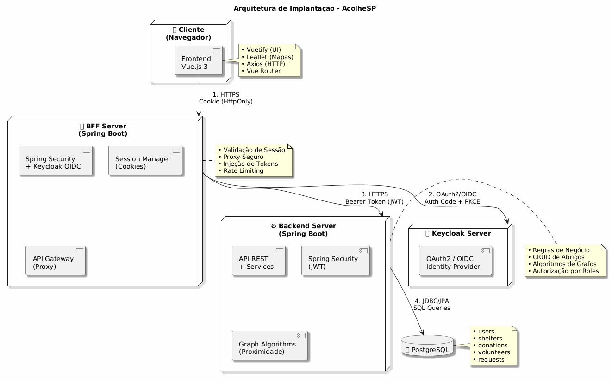

# AcolheSP

Projeto multidisciplinar do 6º semestre do curso de Ciência da Computação, desenvolvido com a integração das disciplinas de:

- Interação Humano-Computador (IHC);
- Laboratório de Engenharia de Software;
- Teoria dos Grafos.

O projeto está relacionado ao Objetivo de Desenvolvimento Sustentável 1 — Erradicação da Pobreza, estabelecido pela Organização das Nações Unidas (ONU).

## 1. Apresentação do projeto 📖

O AcolheSP é uma plataforma web voltada ao mapeamento de locais que oferecem abrigo, alimentação e assistência a pessoas em situação de rua na cidade de São Paulo.

A proposta é aproximar instituições de assistência social de pessoas interessadas em contribuir por meio de doações e trabalho voluntário. Para isso, a plataforma reúne informações sobre os locais de atendimento e suas necessidades.

Os principais usuários previstos são:

- Administradores de abrigos e instituições, responsáveis por cadastrar e atualizar as informações dos locais e suas necessidades;
- Pessoas interessadas em ajudar, que procuram instituições para realizar doações ou atuar como voluntárias.

As pessoas em situação de rua constituem o público beneficiário da iniciativa, ainda que a interação com a plataforma seja realizada principalmente por administradores e colaboradores.

### 1.1. Objetivos do projeto 🎯

#### Objetivo geral

Facilitar a localização de instituições de assistência social na cidade de São Paulo e a conexão entre essas instituições e pessoas dispostas a ajudar.

#### Objetivos específicos

- Disponibilizar um mapa com a localização dos espaços de assistência;
- Permitir a consulta de informações sobre as instituições;
- Possibilitar o cadastro e a atualização dos dados dos abrigos;
- Divulgar necessidades de produtos, recursos e voluntariado;
- Facilitar a identificação de instituições próximas à localização do usuário;
- Desenvolver uma interface acessível e de fácil utilização;
- Aplicar conhecimentos de engenharia de software, interação humano-computador e teoria dos grafos.

### 1.2. Relação com a ODS 1 🌍

O projeto busca contribuir para a ODS 1 ao facilitar a divulgação de serviços de apoio e das necessidades de instituições que atendem pessoas em situação de vulnerabilidade socioeconômica.

A contribuição proposta está na organização das informações e na aproximação entre instituições e colaboradores. A plataforma não substitui políticas públicas ou serviços de assistência social, mas pretende atuar como ferramenta de apoio a essas iniciativas.

### 1.3. Integração entre as disciplinas 📚

| Disciplina | Aplicação no projeto |
| --- | --- |
| Interação Humano-Computador | Planejamento da interface e dos fluxos de navegação, considerando clareza, usabilidade e diversidade dos usuários. |
| Laboratório de Engenharia de Software | Levantamento de requisitos, estudo de viabilidade, modelagem, implementação, testes e documentação. |
| Teoria dos Grafos | Modelagem e estudo de soluções para recomendar instituições próximas ao usuário. |

## 2. Principais funcionalidades e resultados alcançados ✅

O escopo do projeto contempla as funcionalidades abaixo.

| Funcionalidade | Descrição | Situação na entrega |
| --- | --- | --- |
| Consulta de instituições | Busca e consulta dos locais de assistência cadastrados. | Concluída |
| Visualização no mapa | Exibição geográfica dos locais de atendimento. | Concluída |
| Detalhes da instituição | Consulta de endereço, contato e serviços oferecidos. | Concluída |
| Cadastro e atualização de abrigos | Gerenciamento das informações pelos responsáveis pelas instituições. | Parcial |
| Cadastro e consulta de necessidades | Divulgação dos produtos e recursos solicitados pelas instituições. | Parcial |
| Apoio a doações | Registro ou encaminhamento do interesse em atender uma necessidade. | Concluída |
| Interesse em voluntariado | Manifestação de interesse em colaborar com uma instituição. | Concluída |
| Recomendação por proximidade | Identificação de locais próximos à localização do usuário. | Concluída |

### 2.1. Síntese dos resultados 📋

Na versão final, foram concluídas as seguintes entregas:

- Frontend funcional e capaz de listar Centros de Acolhida próximos do usuário ao clicar para definir a localização.
- Capacidade de realizar login tanto como abrigo quanto como voluntário.
- Capacidade de cadastrar necessidades e horários de voluntariado (Usuário Abrigo).
- Capacidade de se vincular à necessidades e horários de voluntariado (Usuário Voluntário).

As limitações identificadas nesta versão são:

- Falta de desenvolvimento do sistema de segurança (**IMPORTANTE: NÃO DEVE SE CADASTRAR COM DADOS REAIS**)
- Incapacidade de editar perfil de usuário Voluntário e Abrigo (Além de não poder cadastrar foto de perfil).

## 3. Arquitetura do sistema 🏗️

### 3.1. Diagrama de arquitetura 🖼️



O diagrama apresenta a organização dos componentes e do ambiente de implantação do projeto.

### 3.2. Organização dos componentes 🧩

O projeto está organizado em frontend, BFF, backend e banco de dados.

| Componente | Responsabilidade prevista |
| --- | --- |
| Frontend | Apresentar a interface, os formulários, os mapas e as informações ao usuário. |
| BFF — Backend for Frontend | Intermediar a comunicação entre a interface e o backend, oferecendo os dados necessários às telas. |
| Backend | Processar regras de negócio, validar operações e realizar o acesso aos dados. |
| Banco de dados | Armazenar as informações utilizadas pela aplicação. |

O fluxo de comunicação previsto é:

```text
Usuário
   |
   v
Frontend — Vue.js
   |
   v
BFF — Spring Boot
   |
   v
Backend — Spring Boot
   |
   v
PostgreSQL
```

### 3.3. Organização interna do backend 📂

Os diretórios do backend separam as responsabilidades da aplicação:

- `config`: configurações da aplicação;
- `controller`: recebimento das requisições HTTP;
- `dto`: estruturas de transferência de dados;
- `model`: representação das entidades;
- `repository`: acesso e persistência de dados;
- `service`: regras de negócio;
- `utils`: funções e recursos auxiliares.

## 4. Tecnologias utilizadas 🛠️

### Frontend

- Vue.js 3 — desenvolvimento da interface;
- Vite — ambiente de desenvolvimento e build;
- Vue Router — gerenciamento das rotas;
- Axios — comunicação HTTP com os serviços;
- Vuetify — componentes de interface;
- Leaflet — exibição e interação com mapas.

### Backend e BFF

- Java 21;
- Spring Boot — desenvolvimento dos serviços e APIs REST;
- Spring Security — configuração da camada de segurança;
- Maven e Maven Wrapper — gerenciamento e execução dos projetos Java.

### Banco de dados e ferramentas

- PostgreSQL — banco de dados relacional;
- Docker e Docker Compose — execução dos serviços definidos na configuração de containers;
- Git — controle de versão;
- GitHub Actions — automação dos testes, conforme descrito na seção de testes.

## 5. Estrutura de pastas 📂

A estrutura abaixo apresenta os principais diretórios, omitindo dependências instaladas e arquivos gerados durante a compilação.

```text
Projeto-Multidisciplinar/
├── backend
│   ├── db
│   └── demo
│       ├── src
│       │   ├── main
│       │   │   ├── java
│       │   │   │   └── com
│       │   │   │       └── AcolheSP
│       │   │   │           └── demo
│       │   │   │               ├── config
│       │   │   │               ├── controller
│       │   │   │               ├── dto
│       │   │   │               ├── model
│       │   │   │               ├── repository
│       │   │   │               ├── service
│       │   │   │               └── utils
│       │   │   └── resources
│       │   └── test
│       │       ├── java
│       │       │   └── com
│       │       │       └── AcolheSP
│       │       │           └── demo
│       │       │               ├── config
│       │       │               ├── controller
│       │       │               ├── repository
│       │       │               └── service
│       │       └── resources
│       └── target
│           ├── classes
│           │   └── com
│           │       └── AcolheSP
│           │           └── demo
│           │               ├── config
│           │               ├── controller
│           │               ├── dto
│           │               ├── model
│           │               ├── repository
│           │               ├── service
│           │               └── utils
│           ├── generated-sources
│           │   └── annotations
│           ├── generated-test-sources
│           │   └── test-annotations
│           ├── maven-status
│           │   └── maven-compiler-plugin
│           │       ├── compile
│           │       │   └── default-compile
│           │       └── testCompile
│           │           └── default-testCompile
│           ├── surefire-reports
│           └── test-classes
│               ├── com
│               │   └── AcolheSP
│               │       └── demo
│               │           ├── config
│               │           ├── controller
│               │           ├── repository
│               │           └── service
│               └── db
├── BFF
│   └── bff
│       ├── src
│       │   ├── main
│       │   │   ├── java
│       │   │   │   └── com
│       │   │   │       └── AcolheSP
│       │   │   │           └── bff
│       │   │   │               ├── config
│       │   │   │               ├── controller
│       │   │   │               ├── dto
│       │   │   │               ├── service
│       │   │   │               └── util
│       │   │   └── resources
│       │   │       ├── static
│       │   │       └── templates
│       │   └── test
│       │       └── java
│       │           └── com
│       │               └── AcolheSP
│       │                   └── bff
│       │                       └── controller
│       └── target
│           ├── classes
│           │   └── com
│           │       └── AcolheSP
│           │           └── bff
│           │               ├── config
│           │               ├── controller
│           │               ├── dto
│           │               ├── service
│           │               └── util
│           ├── generated-sources
│           │   └── annotations
│           ├── generated-test-sources
│           │   └── test-annotations
│           ├── maven-status
│           │   └── maven-compiler-plugin
│           │       ├── compile
│           │       │   └── default-compile
│           │       └── testCompile
│           │           └── default-testCompile
│           └── test-classes
│               └── com
│                   └── AcolheSP
│                       └── bff
│                           └── controller
├── centro_acolhida_adultos_geocodificado.txt
├── database
├── docs
│   ├── generics
│   └── wireframe
├── frontend
│   ├── node_modules
│   │   ├── agent-base
│   │   │   ├── dist
│   │   │   │   └── src
│   │   │   └── src
│   │   ├── asynckit
│   │   │   └── lib
│   │   ├── axios
│   │   │   ├── dist
│   │   │   │   ├── browser
│   │   │   │   ├── esm
│   │   │   │   └── node
│   │   │   └── lib
│   │   │       ├── adapters
│   │   │       ├── cancel
│   │   │       ├── core
│   │   │       ├── defaults
│   │   │       ├── env
│   │   │       │   └── classes
│   │   │       ├── helpers
│   │   │       └── platform
│   │   │           ├── browser
│   │   │           │   └── classes
│   │   │           ├── common
│   │   │           └── node
│   │   │               └── classes
│   │   ├── @babel
│   │   │   ├── helper-string-parser
│   │   │   │   └── lib
│   │   │   ├── helper-validator-identifier
│   │   │   │   └── lib
│   │   │   ├── parser
│   │   │   │   ├── bin
│   │   │   │   ├── lib
│   │   │   │   └── typings
│   │   │   └── types
│   │   │       └── lib
│   │   │           ├── asserts
│   │   │           │   └── generated
│   │   │           ├── ast-types
│   │   │           │   └── generated
│   │   │           ├── builders
│   │   │           │   ├── flow
│   │   │           │   ├── generated
│   │   │           │   ├── react
│   │   │           │   └── typescript
│   │   │           ├── clone
│   │   │           ├── comments
│   │   │           ├── constants
│   │   │           │   └── generated
│   │   │           ├── converters
│   │   │           ├── definitions
│   │   │           ├── modifications
│   │   │           │   ├── flow
│   │   │           │   └── typescript
│   │   │           ├── retrievers
│   │   │           ├── traverse
│   │   │           ├── utils
│   │   │           │   └── react
│   │   │           └── validators
│   │   │               ├── generated
│   │   │               └── react
│   │   ├── call-bind-apply-helpers
│   │   │   └── test
│   │   ├── combined-stream
│   │   │   └── lib
│   │   ├── csstype
│   │   ├── debug
│   │   │   └── src
│   │   ├── delayed-stream
│   │   │   └── lib
│   │   ├── detect-libc
│   │   │   └── lib
│   │   ├── dunder-proto
│   │   │   └── test
│   │   ├── entities
│   │   │   ├── dist
│   │   │   │   ├── commonjs
│   │   │   │   │   ├── generated
│   │   │   │   │   └── internal
│   │   │   │   └── esm
│   │   │   │       ├── generated
│   │   │   │       └── internal
│   │   │   └── src
│   │   │       ├── generated
│   │   │       └── internal
│   │   ├── es-define-property
│   │   │   └── test
│   │   ├── es-errors
│   │   │   └── test
│   │   ├── es-object-atoms
│   │   │   └── test
│   │   ├── es-set-tostringtag
│   │   │   └── test
│   │   ├── estree-walker
│   │   │   ├── dist
│   │   │   │   ├── esm
│   │   │   │   └── umd
│   │   │   ├── src
│   │   │   └── types
│   │   ├── fdir
│   │   │   └── dist
│   │   ├── follow-redirects
│   │   ├── form-data
│   │   │   └── lib
│   │   ├── function-bind
│   │   │   └── test
│   │   ├── get-intrinsic
│   │   │   └── test
│   │   ├── get-proto
│   │   │   └── test
│   │   ├── gopd
│   │   │   └── test
│   │   ├── hasown
│   │   ├── has-symbols
│   │   │   └── test
│   │   │       └── shams
│   │   ├── has-tostringtag
│   │   │   └── test
│   │   │       └── shams
│   │   ├── https-proxy-agent
│   │   │   └── dist
│   │   ├── @jridgewell
│   │   │   └── sourcemap-codec
│   │   │       ├── dist
│   │   │       ├── src
│   │   │       └── types
│   │   ├── leaflet
│   │   │   ├── dist
│   │   │   │   └── images
│   │   │   └── src
│   │   │       ├── control
│   │   │       ├── core
│   │   │       ├── dom
│   │   │       ├── geo
│   │   │       │   ├── crs
│   │   │       │   └── projection
│   │   │       ├── geometry
│   │   │       ├── images
│   │   │       ├── layer
│   │   │       │   ├── marker
│   │   │       │   ├── tile
│   │   │       │   └── vector
│   │   │       └── map
│   │   │           └── handler
│   │   ├── lightningcss
│   │   │   └── node
│   │   ├── lightningcss-linux-x64-gnu
│   │   ├── lightningcss-linux-x64-musl
│   │   ├── magic-string
│   │   │   └── dist
│   │   ├── math-intrinsics
│   │   │   ├── constants
│   │   │   └── test
│   │   ├── mime-db
│   │   ├── mime-types
│   │   ├── ms
│   │   ├── nanoid
│   │   │   ├── async
│   │   │   ├── bin
│   │   │   ├── non-secure
│   │   │   └── url-alphabet
│   │   ├── @oxc-project
│   │   │   └── types
│   │   ├── picocolors
│   │   ├── picomatch
│   │   │   └── lib
│   │   ├── postcss
│   │   │   └── lib
│   │   ├── proxy-from-env
│   │   ├── @rolldown
│   │   │   ├── binding-linux-x64-gnu
│   │   │   ├── binding-linux-x64-musl
│   │   │   └── pluginutils
│   │   │       └── dist
│   │   │           └── filter
│   │   ├── rolldown
│   │   │   ├── bin
│   │   │   └── dist
│   │   │       └── shared
│   │   ├── source-map-js
│   │   │   └── lib
│   │   ├── tinyglobby
│   │   │   └── dist
│   │   ├── vite
│   │   │   ├── bin
│   │   │   ├── dist
│   │   │   │   ├── client
│   │   │   │   └── node
│   │   │   │       └── chunks
│   │   │   ├── misc
│   │   │   └── types
│   │   │       └── internal
│   │   ├── @vitejs
│   │   │   └── plugin-vue
│   │   │       └── dist
│   │   ├── @vue
│   │   │   ├── compiler-core
│   │   │   │   └── dist
│   │   │   ├── compiler-dom
│   │   │   │   └── dist
│   │   │   ├── compiler-sfc
│   │   │   │   └── dist
│   │   │   ├── compiler-ssr
│   │   │   │   └── dist
│   │   │   ├── reactivity
│   │   │   │   └── dist
│   │   │   ├── runtime-core
│   │   │   │   └── dist
│   │   │   ├── runtime-dom
│   │   │   │   └── dist
│   │   │   ├── server-renderer
│   │   │   │   └── dist
│   │   │   └── shared
│   │   │       └── dist
│   │   ├── vue
│   │   │   ├── compiler-sfc
│   │   │   ├── dist
│   │   │   ├── jsx-runtime
│   │   │   └── server-renderer
│   │   └── @vue-leaflet
│   │       └── vue-leaflet
│   │           └── dist
│   │               └── src
│   │                   ├── components
│   │                   ├── functions
│   │                   └── types
│   │                       ├── enums
│   │                       └── interfaces
│   ├── public
│   ├── src
│   │   ├── assets
│   │   ├── components
│   │   └── services
│   └── tests
└── TeoriaGrafo
    └── graphFinal
        ├── FFilaCircular
        ├── GrafoLista
        ├── GrafoMatriz
        └── PPilha
```

## 6. Como executar a aplicação ⚙️

### 6.1. Pré-requisitos 📝

- Git;
- Node.js e npm;
- Java 21;
- Docker com Docker Compose;
- Maven, caso não seja utilizado o Maven Wrapper presente nos projetos.

Versões utilizadas pelo grupo:

| Ferramenta | Versão |
| --- | --- |
| Node.js | v24.19.0 |
| npm | 11.17.0 |
| Java | 21 |
| Docker | 4.99.0 |

### 6.2. Obter o projeto 📥

Clone o repositório e entre na pasta do projeto:

```bash
git clone <URL_DO_REPOSITORIO>
cd Projeto-Multidisciplinar/
```

### 6.3. Configurar o ambiente 🔧

Antes de iniciar os serviços, confira as configurações de conexão entre frontend, BFF, backend e banco de dados. Em geral, o proxy já está configurado no `application.properties` do BFF/Backend e no `vite.config.js` do frontend. Para configurar o banco de dados, precisa-se criar um .env na root do projeto de seguinte estrutura:

```txt
POSTGRES_USER=
POSTGRES_PASSWORD=
POSTGRES_DB=
```

Como é realizado para testes, e problemas de comunicação, um dos desenvolvedores manteve exposto no `application.properties` do backend, portanto, é só pegar os dados de lá e inserir no .env na root do projeto (Deve ser igual ambos).

### 6.4. Inicializar o banco de dados ▶️

No diretório que contém o arquivo do Docker Compose, execute:

```bash
docker compose up -d
```

Mantenha os containers em execução enquanto utilizar a aplicação.

### 6.5. Executar o backend ▶️

Em um novo terminal, a partir da raiz do repositório:

```bash
cd backend/demo
./mvnw spring-boot:run
```

No Windows, utilizando o Prompt de Comando:

```bat
mvnw.cmd spring-boot:run
```

### 6.6. Executar o BFF ▶️

Em outro terminal, a partir da raiz do repositório:

```bash
cd BFF/bff
./mvnw spring-boot:run
```

No Windows, utilizando o Prompt de Comando:

```bat
mvnw.cmd spring-boot:run
```

### 6.7. Executar o frontend ▶️

Em outro terminal, a partir da raiz do repositório:

```bash
cd frontend
npm install
npm run dev
```

Acesse o endereço informado pelo Vite no terminal.

### 6.8. Endereços locais 🌐

| Serviço | Endereço |
| --- | --- |
| Frontend | http://localhost:5173 |
| BFF | http://localhost:8081/ |
| Backend | http://localhost:8080/ |

### 6.9. Encerrar a aplicação ⏹️

Encerre os processos do frontend, BFF e backend com `Ctrl+C` nos respectivos terminais.

Para interromper os serviços do Docker Compose, execute no diretório da configuração:

```bash
docker compose down
```

## 7. Testes automatizados 🧪

### 7.1. Escopo dos testes 📋

Os testes automatizados foram implementados no backend e abrangem controllers, fluxos de integração da API, segurança, regras de negócio, concorrência e configuração do banco de dados.

A suíte atual contém 177 testes:

- 152 testes existentes;
- 18 testes de fluxos da API;
- 4 testes de concorrência;
- 3 testes de configuração e migração do banco.

Entre os cenários verificados estão autenticação, sessão, proteção CSRF, autorização por usuário e instituição, horários de voluntariado, candidaturas, doações e controle de operações simultâneas.

Também foram realizados testes manuais de integração entre BFF e backend, utilizando comandos como:

```bash
curl -i "http://localhost:8081<endpoint>"
```

O frontend foi verificado manualmente no navegador, observando os fluxos da interface e as respostas e os erros apresentados no console. Essas verificações são complementares aos testes automatizados.

A validação da suíte e da migração incremental em PostgreSQL real ainda está pendente.

### 7.2. Executar os testes localmente ▶️

#### Backend

A partir da raiz do repositório:

```bash
cd backend/demo
mvn test
# Se todas as dependências já estiverem no cache:
mvn -o test
# Recompilar, testar e gerar o JAR sem artefatos anteriores:
mvn -o clean package
```

Os comandos acima utilizam o Maven instalado. Caso utilize o Maven Wrapper, substitua `mvn` por `./mvnw` no Linux/macOS ou por `mvnw.cmd` no Prompt de Comando do Windows.

#### Ambiente de testes

- Sem variáveis externas de configuração do banco, a suíte utiliza H2 em modo PostgreSQL, criando e descartando o esquema de testes. Nesse modo, não é necessário iniciar um PostgreSQL externo.
- Para executar com PostgreSQL, disponibilize um banco exclusivo e descartável para testes e configure as variáveis de conexão.
- Não utilize o banco de produção para executar a suíte.

Exemplo de configuração no Linux/macOS:

```bash
export SPRING_DATASOURCE_URL="jdbc:postgresql://localhost:5432/acolhesp_test"
export SPRING_DATASOURCE_USERNAME="<USUARIO_DE_TESTES>"
export SPRING_DATASOURCE_PASSWORD="<SENHA_DE_TESTES>"
```

Esses comandos configuram a conexão; não iniciam o banco de dados.

A migração incremental de `backend/db/` é executada no contexto dos testes após a inicialização do Hibernate. Caso seja utilizado `SPRING_JPA_HIBERNATE_DDL_AUTO=none`, o esquema inicial deve estar previamente preparado, como ocorre no workflow.

#### Relatórios

- Resultados dos testes: `backend/demo/target/surefire-reports/`;
- Relatório de cobertura JaCoCo: `backend/demo/target/site/jacoco/index.html`.

### 7.3. Testes automatizados no GitHub Actions 🤖

O projeto possui execução automatizada dos testes do backend no GitHub Actions, com utilização de PostgreSQL de testes.

- Arquivo do workflow se encontra em `.github/workflows/backend-tests.yml` e está assim:

```yml
name: Backend Tests

on:
  push:
    branches: [main, develop]
    paths:
      - "backend/**"
      - "database/**"
      - ".github/workflows/backend-tests.yml"
  pull_request:
    branches: [main, develop]
    paths:
      - "backend/**"
      - "database/**"
      - ".github/workflows/backend-tests.yml"
  workflow_dispatch:

concurrency:
  group: backend-tests-${{ github.ref }}
  cancel-in-progress: true

jobs:
  test:
    name: Run Backend Tests
    runs-on: ubuntu-latest
    timeout-minutes: 15

    services:
      postgres:
        image: postgres:16
        env:
          POSTGRES_DB: acolhesp_test
          POSTGRES_USER: test
          POSTGRES_PASSWORD: test
        ports:
          - 5432:5432
        options: >-
          --health-cmd "pg_isready -h 127.0.0.1 -U test -d acolhesp_test"
          --health-interval 5s
          --health-timeout 5s
          --health-retries 10

    steps:
      - name: Checkout repository
        uses: actions/checkout@v4

      - name: Set up Java 21
        uses: actions/setup-java@v4
        with:
          distribution: temurin
          java-version: "21"
          cache: maven
          cache-dependency-path: backend/demo/pom.xml

      - name: Initialize test database
        env:
          POSTGRES_CONTAINER_ID: ${{ job.services.postgres.id }}
        run: |
          docker exec -i "$POSTGRES_CONTAINER_ID" \
            psql -U test -d acolhesp_test -v ON_ERROR_STOP=1 \
            < database/init.sql

      - name: Run tests
        working-directory: backend/demo
        env:
          SPRING_DATASOURCE_URL: jdbc:postgresql://localhost:5432/acolhesp_test
          SPRING_DATASOURCE_USERNAME: test
          SPRING_DATASOURCE_PASSWORD: test
          SPRING_JPA_HIBERNATE_DDL_AUTO: none
        run: |
          chmod +x mvnw
          ./mvnw -B clean test

      - name: Coverage summary
        if: always()
        working-directory: backend/demo
        run: |
          CSV=target/site/jacoco/jacoco.csv
          if [ -f "$CSV" ]; then
            awk -F, 'NR>1 {missed+=$8; covered+=$9} END {
              total=missed+covered;
              pct=(total>0)?covered*100/total:0;
              printf "### Cobertura de linhas: %.1f%% (%d de %d)\n", pct, covered, total
            }' "$CSV" >> "$GITHUB_STEP_SUMMARY"
          fi

      - name: Upload test and coverage reports
        if: always()
        uses: actions/upload-artifact@v4
        with:
          name: backend-reports
          path: |
            backend/demo/target/surefire-reports
            backend/demo/target/site/jacoco
          if-no-files-found: ignore
```

As variáveis de conexão selecionam o PostgreSQL utilizado nos testes. A configuração `ddl-auto=none` preserva o esquema previamente inicializado pelo workflow. O driver do banco é selecionado conforme a URL de conexão.

#### Etapas da execução

1. Obtenção do código e preparação do ambiente de execução do backend;
2. Disponibilização do PostgreSQL de testes, inicialização do esquema e configuração das variáveis de conexão;
3. Execução da suíte automatizada, incluindo a migração incremental no contexto dos testes;
4. Consulta do resultado e dos logs na aba **Actions** do repositório. Os relatórios gerados pelo Maven ficam disponíveis no ambiente da execução; sua disponibilização como artefatos depende da configuração do workflow.

#### Evidência da execução

- Execução utilizada como evidência: https://github.com/Giovanni10435/Projeto-Multidisciplinar/actions
- Datas: De 15/10 até 06/11
- Resultado: Apenas dois não passaram (dia 15/10 e 05/11, que foram corrigidos posteriormente), mas o restante passou corretamente.
- Quantidade de testes: A suíte documentada contém 177 testes

## 8. Deploy da aplicação 🚀

### 8.1. Ambiente de produção 🌐

| Componente | Plataforma ou serviço utilizado | Endereço público |
| --- | --- | --- |
| Frontend | Render | https://acolhesp-frontend-yvvk.onrender.com/ |
| BFF | Render | https://acolhesp-tj9p.onrender.com/api/abrigos |
| Backend | Render | https://acolhesp-backend-9acx.onrender.com/api/abrigos |
| PostgreSQL | Render | Dados não serão divulgados por segurança |

### 8.2. Processo de deploy 📦

1. Criação de Dockerfile para Backend e BFF
2. Carregamento do banco de dados PostgreSQL no Render
3. Carregamento do contâiner com Backend no Render e inserção do link interno, username e senha do Banco de Dados
4. Carregamento do contâiner com BFF com redirecionamento para o Backend
5. Carregamento da página estática do frontend
6. Configuração do proxy do frontend para o BFF

Informações complementares:

- Forma de publicação: Publicação por Render, indicando Branch ideal
- Branch ou versão publicada: deploy
- Configurações específicas de produção: Tanto frontend quanto banco estão nativamente instalados no Render, já BFF e Backend que foi construído em Spring Boot foi necessário dar deploy em Contâiner
- Procedimento para atualizar a aplicação: Dar commit na branch deploy atualiza automáticamente a publicação

### 8.3. Dificuldades e experiências no deploy 📝

| Dificuldade encontrada | Como foi identificada | Solução aplicada | Aprendizado |
| --- | --- | --- | --- |
| Realizar proxy do frontend para o BFF | Erro 500 no frontend ao dar 'GET /api/abrigos' | Encontrar onde redireciona do frontend para o BFF no Render | Ajustar redirecionamento em Redirects/Rewrites |
| Carregar dados de um txt na máquina local no Banco de Dados do Render | Ao dar curl -i <link-do-backend> ele só retornou os 3 abrigos testes criados, não os 119 coletados do site da prefeitura | Conectar meu terminal local ao banco de dados e carregar rodar o script python que insere dados no postgres de forma remota | Atualizar por terminal o Banco de Dados |

### 8.4. Demonstração em produção 🎥

Para rodar, deve primeiramente, acessar o Link do Backend, BFF e do Frontend para o render ligar a aplicação (modo gratuito faz com que, após 15 minutos sem acesso, ele desligue a aplicação em deploy).

- Frontend: https://acolhesp-frontend-yvvk.onrender.com/
- Backend: https://acolhesp-backend-9acx.onrender.com/api/abrigos
- BFF: https://acolhesp-tj9p.onrender.com/api/abrigos
- Vídeo de demonstração: [PREENCHER: URL];

O vídeo apresenta a aplicação no endereço de produção e demonstra as funcionalidades concluídas.

## 9. Pontos de melhoria e evolução 🔧

As possibilidades de evolução incluem:

- Realizar avaliações de usabilidade com administradores de instituições e pessoas interessadas em ajudar;
- Aprimorar a acessibilidade e a experiência de uso em dispositivos móveis;
- Ampliar a cobertura dos testes automatizados;
- Melhorar os mecanismos de validação e atualização dos dados das instituições;
- Aperfeiçoar a recomendação por proximidade, considerando os critérios de distância utilizados;
- Evoluir o acompanhamento das necessidades e das contribuições recebidas;
- Aprimorar a observabilidade da aplicação, com registros e acompanhamento de falhas;
- Revisar os controles de acesso e a proteção dos dados pessoais;
- Ampliar a documentação de instalação, manutenção e operação.

As prioridades identificadas pelo grupo para a próxima versão são:

1. Aprimorar a acessibilidade e a experiência de uso em dispositivos móveis;
2. Melhorar os mecanismos de validação e atualização dos dados das instituições;
3. Revisar os controles de acesso e a proteção dos dados pessoais;

## 10. Potencial de continuidade 🔮

### Incubadora e extensão universitária

O projeto pode evoluir por meio de parcerias com organizações sociais, programas de extensão e iniciativas de incubação.

Essa continuidade dependeria da validação da demanda com as instituições, da definição de responsáveis pela manutenção e da avaliação dos custos de operação.

Também seria necessário estabelecer procedimentos para manter as informações atualizadas e avaliar os benefícios da plataforma para seus usuários.

## 11. Integrantes 👥

- João Vitor Garcia Aguiar Mintz
- Giovanni Barreiro Garitano de Castro
- Yan Andreotti dos Santos